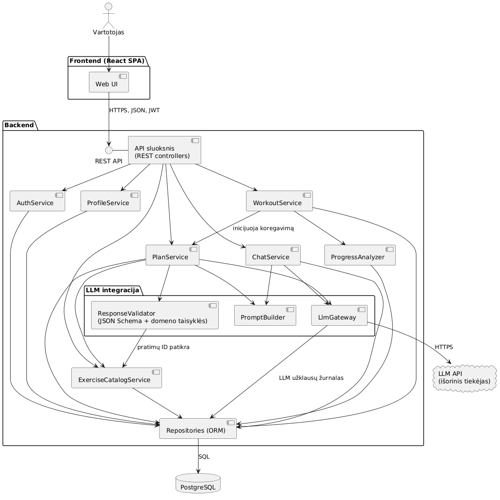

# 🏋️ DI treniruočių planuotojas

**Generatyviuoju dirbtiniu intelektu grįsta adaptyvi sporto treniruočių planavimo informacinė sistema**

Modulis „Gilusis mokymas naudojant TensorFlow“ (VILNIUS TECH), 1 darbas.
Autoriai: **Edvin Gladkich**, **Nojus Sadaunykas**.

## Apie sistemą

Vartotojas nurodo tikslą (raumenų masė, ištvermė, svorio metimas), pasirengimo lygį, turimą įrangą ir laiką. Sistema:

1. atrenka tinkamus pratimus iš katalogo (be LLM);
2. sugeneruoja treniruočių planą su LLM, kuris grąžina JSON pagal schemą;
3. validuoja atsakymą (schema, pratimų ID, krūvio ir trukmės ribos), o nepavykus pakartoja užklausą su klaidų sąrašu (iki 3 kartų);
4. pagal treniruočių rezultatus (RPE, atlikti pakartojimai) koreguoja planą ir išsaugo naują versiją;
5. atsako į klausimus natūralia kalba: DI agentas pats kviečia pratimų paieškos įrankį.

LLM gali naudoti tik katalogo pratimus, o sprendimą, ar reikia koreguoti planą, priima deterministinis analizatorius, todėl sistema nuspėjama ir lengvai paaiškinama.

## Saugyklos struktūra

| Kelias | Turinys | Užduotis |
|---|---|---|
| [`docs/diagrams/`](docs/diagrams/) | 9 diagramos PlantUML ir Mermaid sintakse, PNG paveikslai, `.puml` failai | 1.1 |
| [`prompts/design_prompt.md`](prompts/design_prompt.md) | Promptas, kuriuo sugeneruotos diagramos | 1.1 |
| [`data/`](data/) | Pratimų katalogas ir 5 End-to-End (X, y) poros | 1.2.1 |
| [`prompts/test_prompt.md`](prompts/test_prompt.md) | Testavimo promptas GPT agentui | 1.2.1 |
| [`prompts/responses/`](prompts/responses/) | GPT agento atsakymas į testavimo promptą | 1.2.1 |
| [`prompts/system_prompt.md`](prompts/system_prompt.md) | Sistemos instrukcijos, naudojamos Colab prototipe | 1.2.2 |
| [`schemas/plan_schema.json`](schemas/plan_schema.json) | Treniruočių plano JSON schema | 1.2.2 |
| [`notebooks/treniruociu_planuotojas_gemini.ipynb`](notebooks/treniruociu_planuotojas_gemini.ipynb) | Veikiantis prototipas su Gemini API | 1.2.2 |

## (X, y) pavyzdžiai

`data/X/` – sistemos įvestis, `data/y/` – pavyzdinis atsakymas (`reference`) ir priėmimo kriterijai (`criteria`). LLM kaskart sugeneruoja šiek tiek kitokį planą, todėl rezultatas vertinamas pagal kriterijus, o ne pagal tikslų sutapimą. Visos poros viename faile – [`data/examples.jsonl`](data/examples.jsonl).

| # | Scenarijus | X (įvestis) | y (kas tikrinama) |
|---|---|---|---|
| 1 | Plano generavimas | Pradedančioji, be įrangos, svorio metimas, 3×30 min | 3 treniruotės, ≤ 30 min, tik pratimai be įrangos ir pradedančiųjų lygio |
| 2 | Plano generavimas | Pažengęs, sporto salė, raumenų masė, 4×60 min | 4 treniruotės, ≤ 60 min, visiems pratimams su svoriais nurodytas svoris |
| 3 | Plano koregavimas | Esamas planas + 3 treniruotės su RPE 9–10 ir neatliktais pakartojimais | Nurodyta pakeitimo priežastis, sumažintas krūvis sunkiems pratimams |
| 4 | Klausimas (agentas) | „Kuo pakeisti prisitraukimus, jei neturiu skersinio?“ | ≥ 2 pasiūlymai iš katalogo, nė vieno pratimo su skersiniu |
| 5 | Nerealus noras | Pradedantysis, 7×180 min | Sistema apriboja iki 4×60 min ir paaiškina kodėl |

## Kaip paleisti

1. Gaukite Gemini API raktą [Google AI Studio](https://aistudio.google.com/apikey).
2. Atidarykite notebook per „Open in Colab“ mygtuką.
3. Colab kairėje atidarykite **Secrets** (🔑), pridėkite `GOOGLE_API_KEY` ir įjunkite „Notebook access“.
4. **Runtime → Run all.** Notebook pats atsisiunčia šią saugyklą ir naudoja jos duomenis.

## 1.3 užduotis: AdventureWorks notebook'ai su Bank Marketing duomenimis

Dėstytojo „AdventureWorks DW using TensorFlow“ (neuroninis tinklas) ir „… Decision Forests“ notebook'ai paaiškinti ir perdaryti su verslo duomenimis – [UCI / Kaggle Bank Marketing](data/bank_marketing/) (ar klientas po skambučio sutiks su terminuotu indėliu; 45 211 klientų, 11,7 % „yes“).

| Notebook | Turinys | |
|---|---|---|
| [`1_3_bank_marketing_nn.ipynb`](notebooks/1_3_bank_marketing_nn.ipynb) | Originalo paaiškinimas, Keras Functional API su preprocessing sluoksniais, klasių svoriai |  |
| [`1_3_bank_marketing_decision_forests.ipynb`](notebooks/1_3_bank_marketing_decision_forests.ipynb) | Originalo paaiškinimas, Random Forest ir Gradient Boosted Trees (YDF – TF-DF įpėdinis), požymių svarba, slenkstis |  |

Rezultatai toje pačioje testavimo aibėje (4 522 klientai):

| Modelis | AUC | Accuracy | Recall |
|---|---|---|---|
| Visada „no“ | 0,500 | 0,884 | 0,000 |
| NN | 0,798 | 0,890 | 0,173 |
| NN su klasių svoriais | 0,791 | 0,820 | 0,586 |
| Random Forest | 0,776 | 0,893 | 0,181 |
| **Gradient Boosted Trees** | **0,802** | 0,894 | 0,226 |

Pagrindinės išvados: su nesubalansuotomis klasėmis accuracy klaidinanti (naivus spėjimas – 88 %); pokalbio trukmė `duration` pašalinta kaip duomenų nutekėjimas; labiausiai sprendimą lemia skambučio mėnuo, kontakto būdas ir ankstesnės kampanijos rezultatas. Originalo `pip install tensorflow_decision_forests` dabartiniame Colab nebeveikia, todėl naudojamas YDF – ta pati biblioteka be TensorFlow priklausomybės.

## 1.4–1.5 užduotys: CNN ir transfer learning

Dėstytojo `cnn.ipynb` (CIFAR-10) ir „Transfer learning 1 / 2“ notebook'ai paaiškinti ir perdaryti su savais duomenimis: [tf_flowers](https://www.tensorflow.org/datasets/catalog/tf_flowers) (3 670 gėlių nuotraukų, 5 klasės) ir sporto nuotraukos iš Wikimedia Commons (sąsaja su mūsų treniruočių planuotoju).

| Notebook | Turinys | |
|---|---|---|
| [`1_4_flowers_cnn.ipynb`](notebooks/1_4_flowers_cnn.ipynb) | CNN nuo nulio, augmentacija, filtrų ir požymių žemėlapių vizualizacija, konvoliucija rankomis su NumPy, MLP palyginimas |  |
| [`1_5_transfer_learning_1_sport_photos.ipynb`](notebooks/1_5_transfer_learning_1_sport_photos.ipynb) | Iš anksto apmokyti TF Hub modeliai sporto nuotraukoms: EfficientNetV2 klasifikacija, objektų aptikimas, segmentacija |  |
| [`1_5_transfer_learning_2_flowers.ipynb`](notebooks/1_5_transfer_learning_2_flowers.ipynb) | Užšaldytas EfficientNetV2-B1 + naujas sluoksnis, fine-tuning |  |

Rezultatai toje pačioje tf_flowers testavimo aibėje (551 nuotrauka):

| Modelis | Mokomų parametrų | Test accuracy |
|---|---|---|
| MLP | 891 365 | 0,394 |
| CNN (originali architektūra) | 1 695 109 | 0,628 |
| CNN + augmentacija + Dropout | 466 309 | 0,722 |
| **Transfer learning** (užšaldytas EfficientNetV2-B1) | 6 405 | **0,946** |
| Fine-tuning (visas modelis, 4 epochos) | 6 866 457 | 0,915 |

Pagrindinės išvados:
- CNN gerokai pranašesnis už MLP.
- Mažam duomenų rinkiniui augmentacija būtina.
- Transfer learning su vos 6 405 mokomais parametrais lenkia CNN nuo nulio 22 procentiniais punktais.
- Fine-tuning su ~2 600 nuotraukų rezultatą pablogino. Originale atšildytas modelis nebuvo perkompiliuotas, todėl tikėtina, kad fine-tuning ten realiai nevyko.
- Iš anksto apmokyti modeliai atpažįsta štangą, dviračius, krepšinį ir tenisą, bet svarstį painioja su hanteliu, o sudėtingų scenų (maratonas, futbolas, plaukimas) neatpažįsta.

Originalo ImageNet-21k klasių failas (`storage.googleapis.com/bit_models/…`) nebepasiekiamas (403), todėl klasės sudaromos iš [timm](https://github.com/huggingface/pytorch-image-models) failų.

## Architektūra

Prototipe vietoj PostgreSQL naudojami CSV ir JSON failai, o vietoj REST API – Python funkcijos. Funkcijos pavadintos pagal komponentų diagramą: `ExerciseCatalogService`, `PromptBuilder`, `LlmGateway`, `ResponseValidator`, `PlanService`, `ProgressAnalyzer`.
