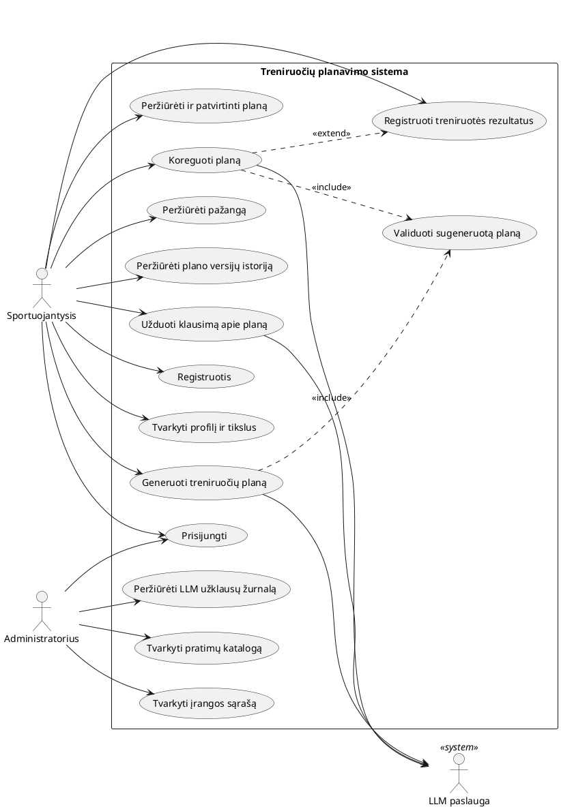
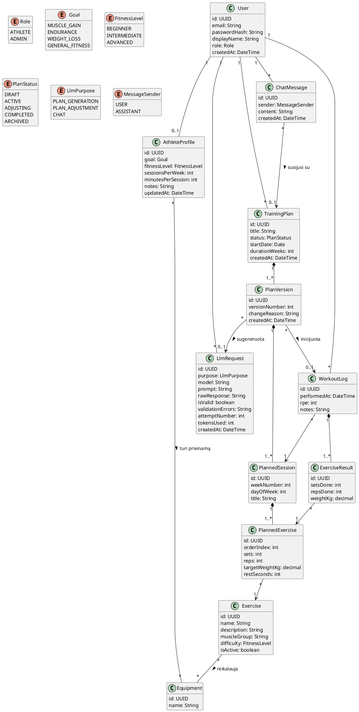
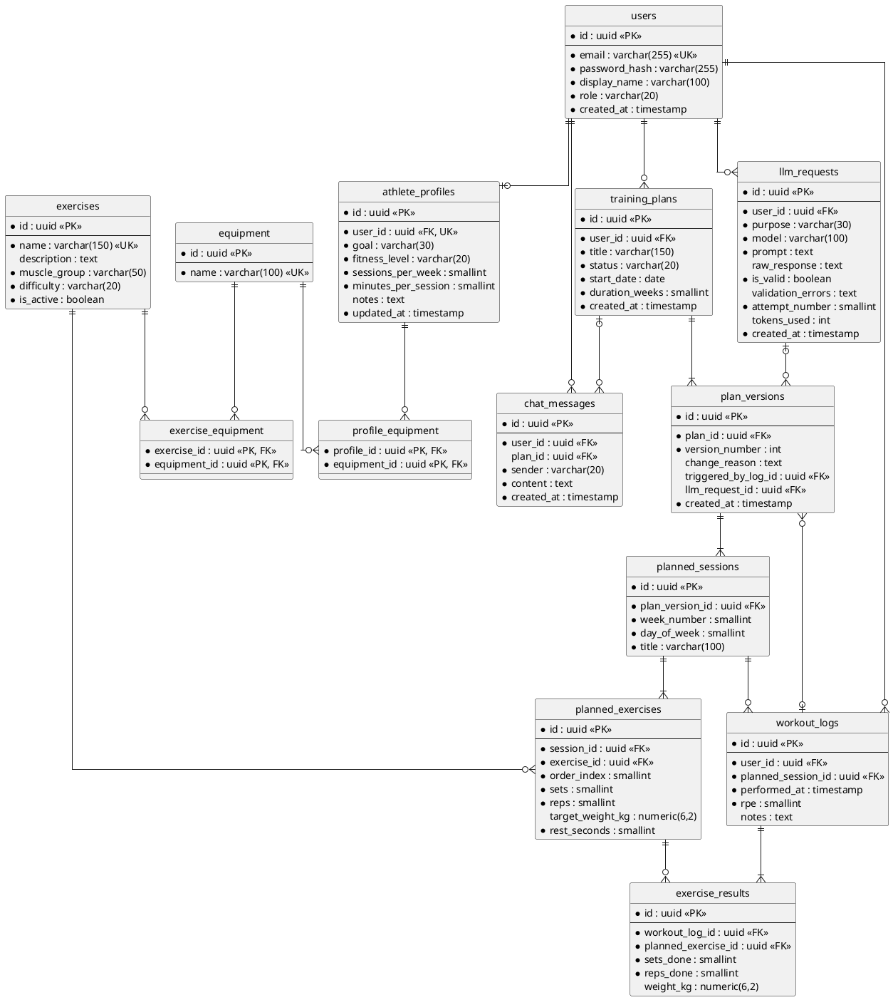
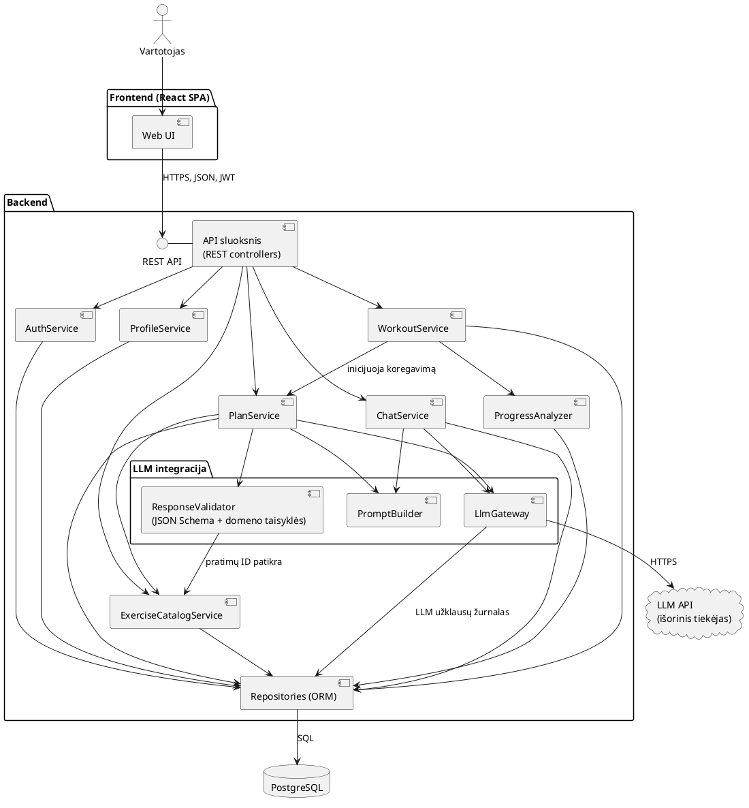
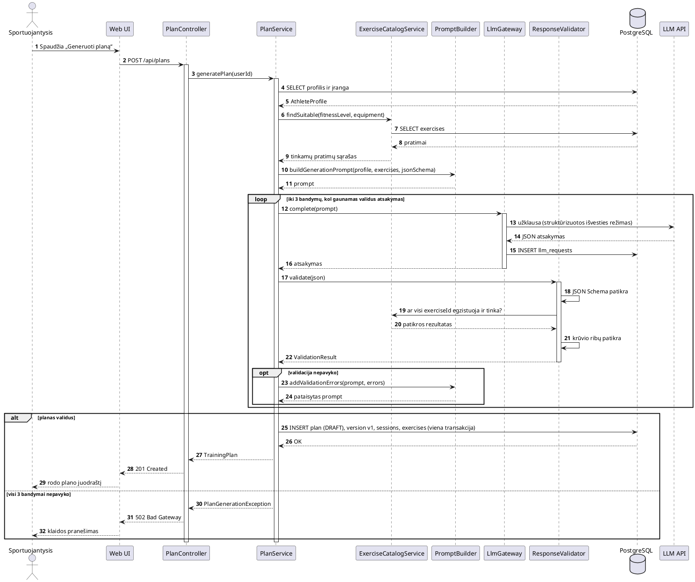
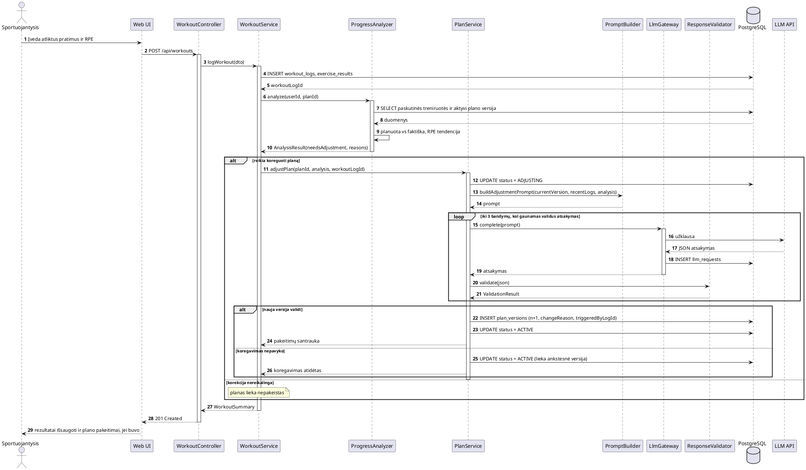
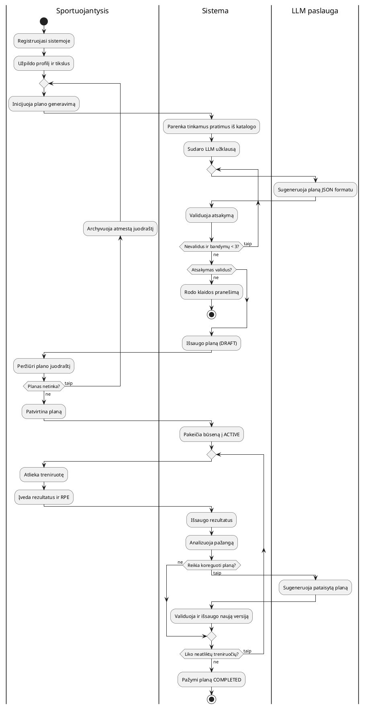
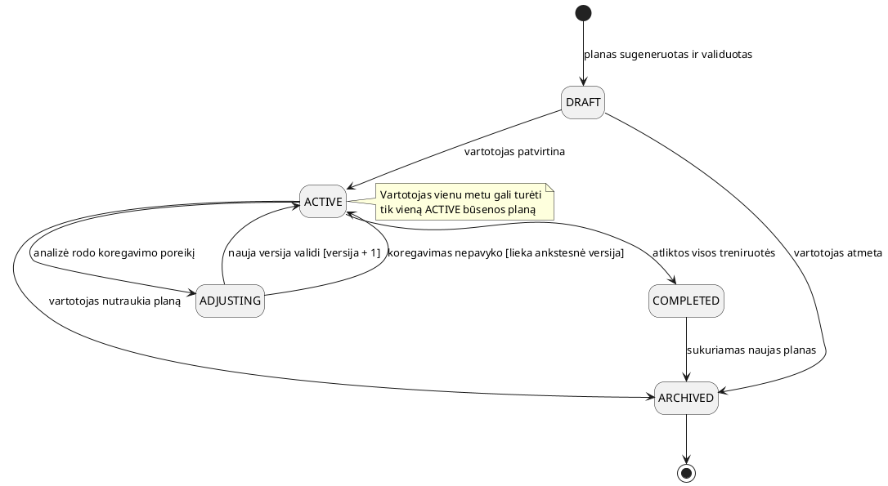
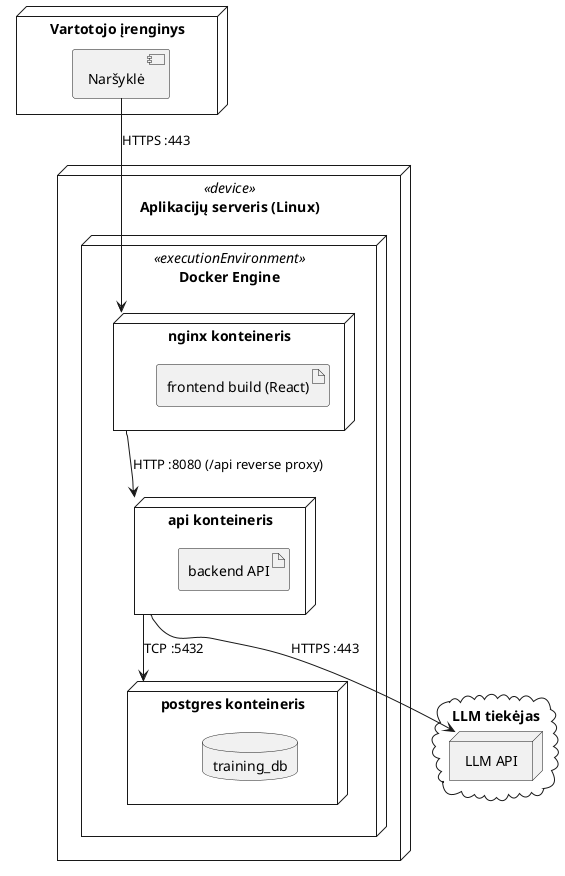

# Treniruočių planavimo sistema – PlantUML diagramos

Techniniai pavadinimai (klasės, lentelės, komponentai, API) – anglų kalba, aprašomieji tekstai – lietuvių kalba. Visos diagramos patikrintos su PlantUML 1.2025.4.

## 1. Panaudos atvejų diagrama

Dvi pagrindinės rolės (sportuojantysis, administratorius) ir LLM paslauga kaip antrinis veikėjas. Plano generavimas ir koregavimas įtraukia (include) bendrą validavimo atvejį, o plano koregavimas išplečia (extend) rezultatų registravimą, nes vyksta tik tada, kai analizė parodo poreikį.

## 2. Domeno modelis (klasių diagrama)

Planas turi versijas (PlanVersion), todėl saugoma pilna koregavimų istorija: kiekviena versija žino, kuri treniruotė (WorkoutLog) ją inicijavo ir kuri LLM užklausa ją sugeneravo. Pratimai planuose visada nurodo katalogo įrašą (Exercise), o ne laisvą tekstą.

## 3. Duomenų bazės ER diagrama

Fizinis modelis PostgreSQL duomenų bazei. Ryšiai daug-su-daug (profilis–įranga, pratimas–įranga) realizuoti tarpinėmis lentelėmis. Lentelė llm_requests saugo kiekvieną LLM kvietimą su atsakymu ir validavimo klaidomis, tai naudinga derinimui ir vertinimui.

## 4. Komponentų diagrama

LLM integracija atskirta į tris komponentus: PromptBuilder sudaro užklausas, LlmGateway bendrauja su išoriniu API ir registruoja kvietimus, ResponseValidator tikrina JSON pagal schemą ir domeno taisykles (pratimų ID, krūvio ribas). Taip LLM tiekėją galima pakeisti nekeičiant verslo logikos.

## 5. Sekų diagrama: plano generavimas

LLM gauna tik tuos pratimus, kurie tinka vartotojo lygiui ir įrangai. Jei atsakymas nevalidus, validavimo klaidos pridedamos prie užklausos ir bandoma dar kartą (iki 3 kartų). Planas išsaugomas vienoje transakcijoje.

## 6. Sekų diagrama: plano koregavimas

ProgressAnalyzer deterministiškai (be LLM) nustato, ar reikia koreguoti planą, pvz., pagal RPE tendenciją ar neatliktus pakartojimus. LLM kviečiamas tik tada, kai korekcija reikalinga. Jei koregavimas nepavyksta, planas lieka su ankstesne versija.

## 7. Veiklos diagrama: vartotojo ciklas

Takeliai (swimlanes) rodo, kas atlieka kiekvieną veiksmą: vartotojas, sistema ar LLM paslauga. Atmetus juodraštį, jis archyvuojamas ir generuojamas naujas planas.

## 8. Būsenų diagrama: treniruočių plano gyvavimo ciklas

Būsena ADJUSTING apsaugo nuo lygiagrečių koregavimų. Abu išėjimai iš ADJUSTING grąžina planą į ACTIVE, skiriasi tik tai, ar sukuriama nauja versija.

## 9. Diegimo diagrama

Frontend, backend ir duomenų bazė veikia atskiruose Docker konteineriuose viename serveryje, nginx atlieka reverse proxy funkciją. Išorinis LLM tiekėjas pasiekiamas per HTTPS.

