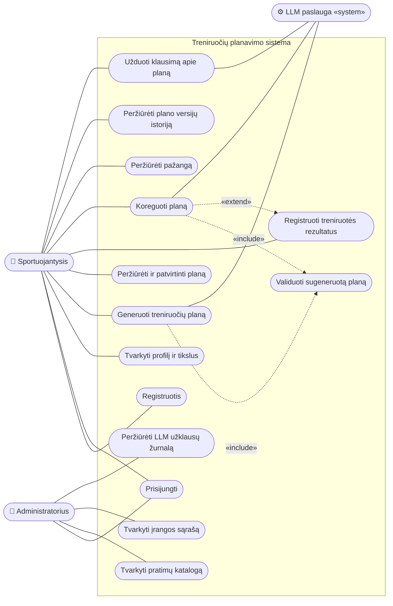
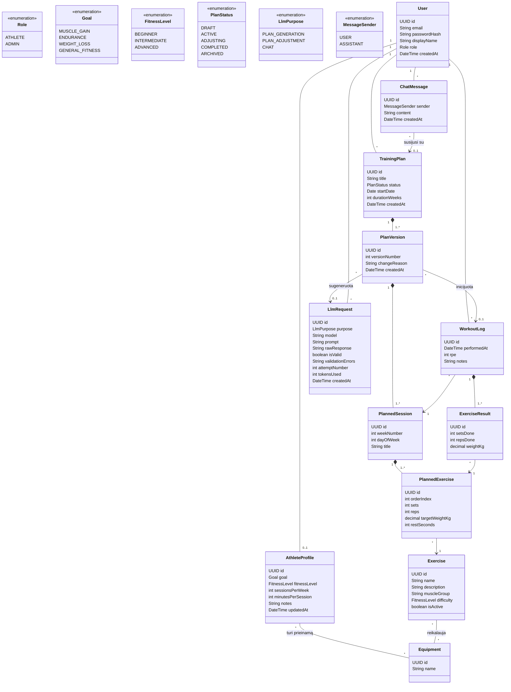
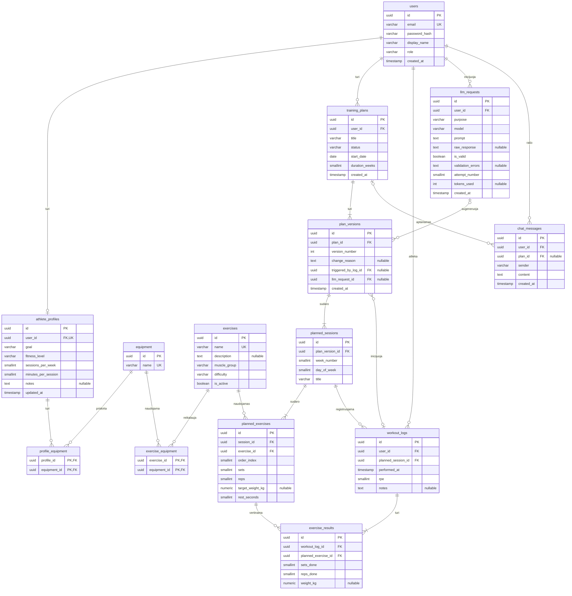
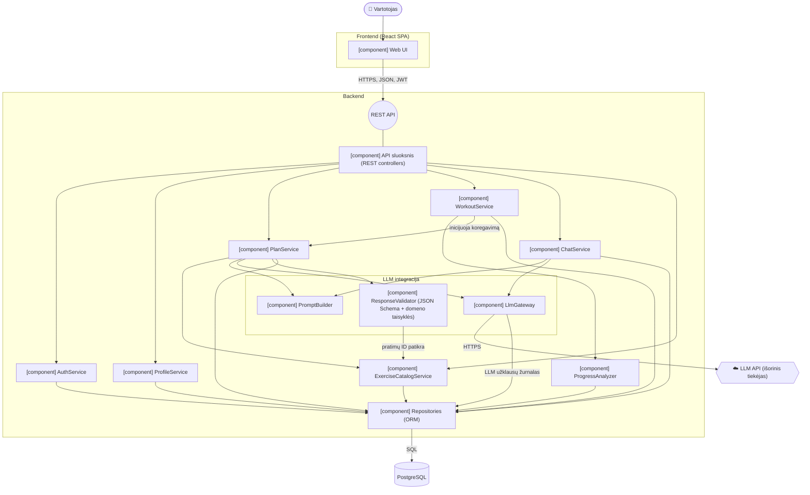
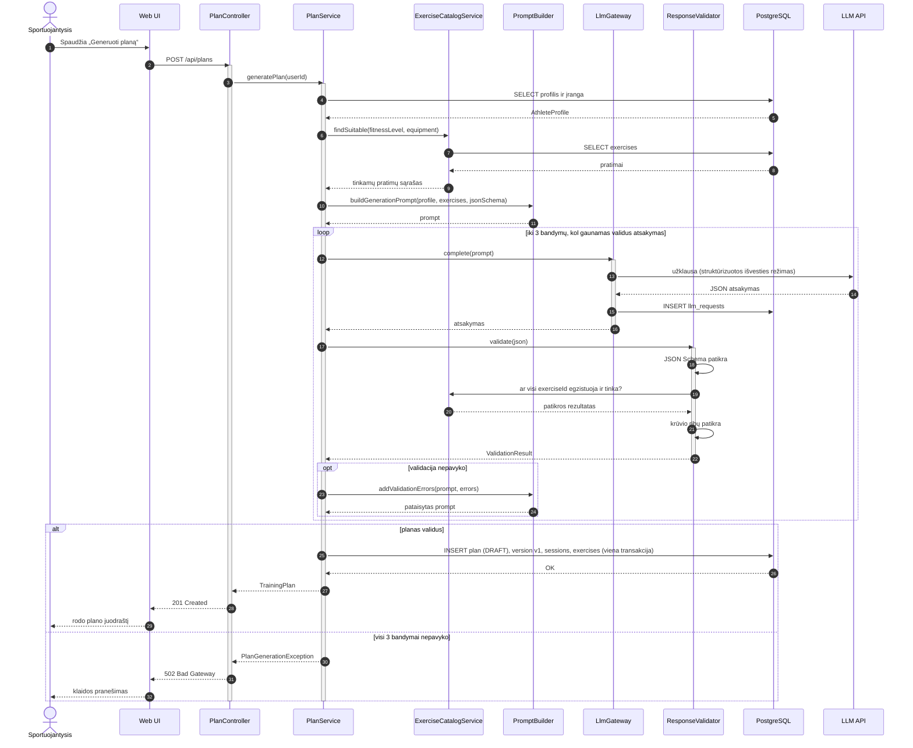
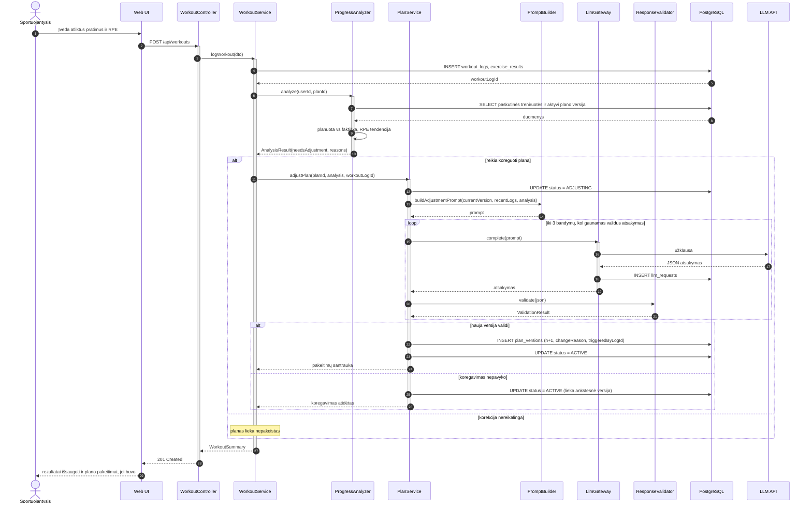
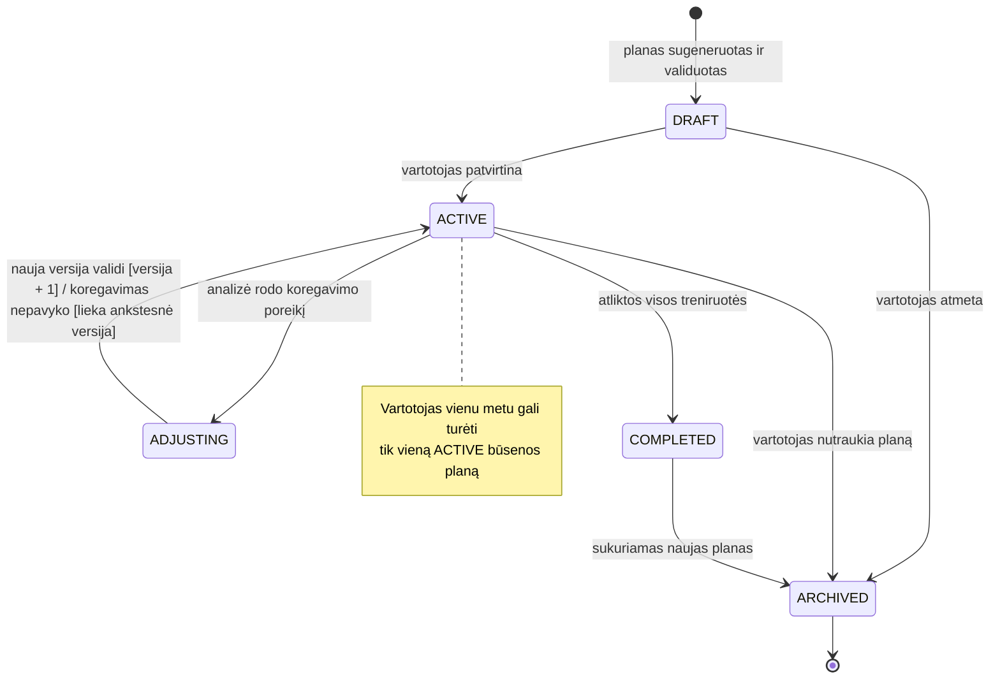
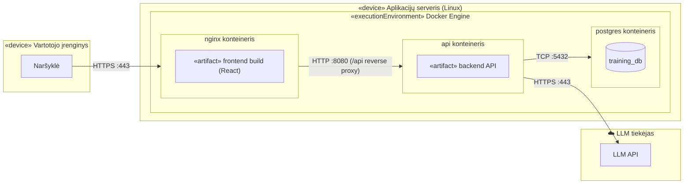

# Treniruočių planavimo sistema – Mermaid diagramos

Mermaid versijos tų pačių 9 diagramų. Patikrinta su Mermaid 12.0. Mermaid neturi atskirų panaudos atvejų, komponentų, veiklos su takeliais ir diegimo diagramų tipų, todėl jos atvaizduotos per `flowchart`.

## 1. Panaudos atvejų diagrama

**Kas prarandama lyginant su PlantUML:** nėra standartinio veikėjo („žmogeliuko“) simbolio ir sistemos ribos stačiakampio semantikos; veikėjai ir panaudos atvejai yra paprasti mazgai, «include»/«extend» – punktyrinės rodyklės su etiketėmis.

## 2. Domeno modelis (klasių diagrama)

**Kas prarandama:** praktiškai nieko – Mermaid classDiagram palaiko kardinalumus, kompoziciją ir enumeracijas. Ryšių pavadinimų krypties rodyklių (►) nėra.

## 3. Duomenų bazės ER diagrama

**Kas prarandama:** Mermaid atributų tipai negali turėti parametrų, todėl `varchar(255)`, `numeric(6,2)` sutrumpinti iki `varchar`, `numeric`. NOT NULL žymėjimas (`*`) pakeistas komentaru „nullable“ prie neprivalomų laukų. Mermaid reikalauja ryšio etiketės, todėl pridėti ryšių pavadinimai.

## 4. Komponentų diagrama

**Kas prarandama:** nėra UML komponento simbolio ir „lollipop“ sąsajos; komponentai pažymėti tekstu `[component]`, REST API sąsaja – apskritimu, LLM API – šešiakampiu (cloud forma yra tik naujausiose Mermaid versijose).

## 5. Sekų diagrama: plano generavimas

**Kas prarandama:** nieko esminio – sequenceDiagram palaiko activate, loop, opt, alt. Duomenų bazė rodoma kaip įprastas dalyvis, o ne cilindras.

## 6. Sekų diagrama: plano koregavimas

**Kas prarandama:** nieko esminio.

## 7. Veiklos diagrama: vartotojo ciklas

```mermaid
flowchart TD
    Start((" ")) --> A1["Registruojasi sistemoje"]
    A1 --> A2["Užpildo profilį ir tikslus"]
    A2 --> A3["Inicijuoja plano generavimą"]
    A3 --> S1["Parenka tinkamus pratimus iš katalogo"]
    S1 --> S2["Sudaro LLM užklausą"]
    S2 --> L1["Sugeneruoja planą JSON formatu"]
    L1 --> S3["Validuoja atsakymą"]
    S3 --> D1{"Nevalidus ir bandymų < 3?"}
    D1 -->|taip| L1
    D1 -->|ne| D2{"Atsakymas validus?"}
    D2 -->|ne| S4["Rodo klaidos pranešimą"]
    S4 --> EndErr(((" ")))
    D2 -->|taip| S5["Išsaugo planą (DRAFT)"]
    S5 --> A4["Peržiūri plano juodraštį"]
    A4 --> D3{"Planas netinka?"}
    D3 -->|taip| S6["Archyvuoja atmestą juodraštį"]
    S6 --> A3
    D3 -->|ne| A5["Patvirtina planą"]
    A5 --> S7["Pakeičia būseną į ACTIVE"]
    S7 --> A6["Atlieka treniruotę"]
    A6 --> A7["Įveda rezultatus ir RPE"]
    A7 --> S8["Išsaugo rezultatus"]
    S8 --> S9["Analizuoja pažangą"]
    S9 --> D4{"Reikia koreguoti planą?"}
    D4 -->|taip| L2["Sugeneruoja pataisytą planą"]
    L2 --> S10["Validuoja ir išsaugo naują versiją"]
    S10 --> D5{"Liko neatliktų treniruočių?"}
    D4 -->|ne| D5
    D5 -->|taip| A6
    D5 -->|ne| S11["Pažymi planą COMPLETED"]
    S11 --> EndOk(((" ")))

    subgraph Legenda
        direction LR
        LA["Sportuojantysis"]
        LS["Sistema"]
        LL["LLM paslauga"]
    end

    classDef athlete fill:#dbeafe,stroke:#1d4ed8,color:#000
    classDef system fill:#dcfce7,stroke:#15803d,color:#000
    classDef llm fill:#fef3c7,stroke:#b45309,color:#000
    classDef terminal fill:#000,stroke:#000
    class A1,A2,A3,A4,A5,A6,A7,LA athlete
    class S1,S2,S3,S4,S5,S6,S7,S8,S9,S10,S11,LS system
    class L1,L2,LL llm
    class Start,EndErr,EndOk terminal
```

**Kas prarandama:** Mermaid neturi takelių (swimlanes), todėl atsakomybė parodyta spalvomis (žr. legendą): mėlyna – sportuojantysis, žalia – sistema, geltona – LLM paslauga. Pradžios ir pabaigos mazgai – juodi apskritimai.

## 8. Būsenų diagrama: treniruočių plano gyvavimo ciklas

**Kas prarandama:** du perėjimai ADJUSTING → ACTIVE sujungti į vieną su dviem sąlygomis, nes Mermaid lygiagrečias rodykles tarp tų pačių būsenų piešia viena ant kitos.

## 9. Diegimo diagrama

**Kas prarandama:** nėra 3D mazgų (node) simbolių; mazgai ir vykdymo aplinkos parodyti įdėtais subgraph blokais su stereotipais tekste.
